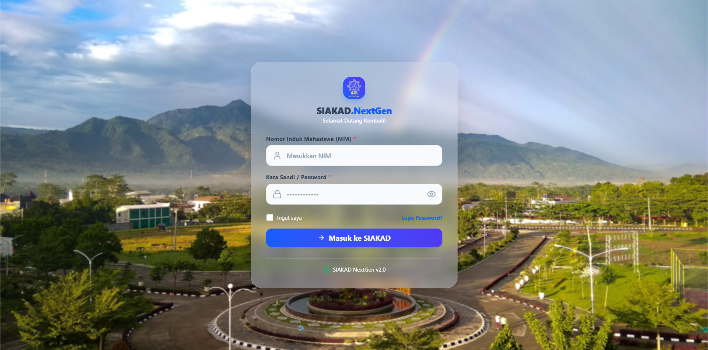
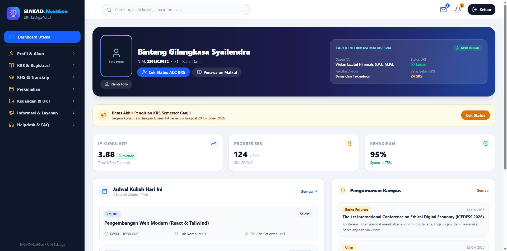

# Tim Push ML doang ga pernah IMMO
# SIAKAD.NextGen UIN Salatiga - Student Academic Portal

## Anggota Tim
1. Bintang Gilangkasa Syailendra
2. Andi Wildan Alvin Ulinnuha

## Tampilan



## Latar Belakang
Pengembangan platform **SIAKAD UIN Salatiga** ini didasari oleh keresahan terhadap sistem informasi akademik kampus eksisting yang dirasa kurang nyaman dari segi pengalaman pengguna (*user experience*) maupun tata letak visual (*user interface*). Beberapa kendala utama yang melatarbelakangi pengerjaan proyek ini antara lain:

1. **Antarmuka Kurang Modern & Kaku**: Tampilan sistem lama cenderung usang, kurang responsif di perangkat seluler, dan menyulitkan navigasi harian mahasiswa.
2. **Fitur Tidak Berfungsi Optimal**: Terdapat beberapa modul krusial pada sistem lama yang sering mengalami kendala teknis atau tidak berfungsi sebagaimana mestinya, seperti halaman jadwal kuliah dan akses silabus perkuliahan.
3. **Kebutuhan Solusi Ramah Pengguna**: Mahasiswa membutuhkan portal akademik yang cepat, konsisten, intuitif, serta memiliki visual yang bersih untuk menunjang kelancaran administrasi perkuliahan dari semester ke semester.

Proyek ini hadir sebagai solusi prototipe SIAKAD yang lebih modern, ramah pengguna, serta memastikan setiap alur fitur akademik dapat berjalan dengan stabil dan responsif.

---

## Nama Website
**SIAKAD UIN Salatiga** (Sistem Informasi Akademik Mahasiswa)

---

## Deskripsi Singkat
**SIAKAD UIN Salatiga** adalah platform Sistem Informasi Akademik berbasis web *frontend* yang dirancang khusus untuk mahasiswa Universitas Islam Negeri Salatiga. Aplikasi ini menyediakan antarmuka pengguna yang modern, intuitif, dan responsif untuk mengelola berbagai kebutuhan administrasi serta informasi akademis, meliputi:

- **Profil & Akun**: Pemantauan status keaktifan akademik, pembimbing akademik (PA), pembaruan biodata diri terintegrasi PDDikti, cetak lembar biodata resmi, dan pembaruan kata sandi akun.
- **KRS & Registrasi**: Informasi penawaran mata kuliah semester aktif, proses pengisian KRS, dan status registrasi akademik.
- **KHS & Transkrip**: Pemantauan Kartu Hasil Studi per semester dan Transkrip Nilai kumulatif mahasiswa.
- **Keuangan & UKT**: Rincian tagihan UKT aktif, panduan interaktif metode pembayaran (Virtual Account & QRIS), serta rekapitulasi histori transaksi pembayaran resmi.
- **Informasi & Layanan**: Berita dan pengumuman kampus terkini serta portal pencarian dan pendaftaran beasiswa.

---

## Teknologi
- **Framework / Library**: React.js (Vite)
- **Styling Framework**: Tailwind CSS
- **Icon Set**: Lucide React (`lucide-react`)
- **State & Routing Management**: React Hooks (`useState`, `useEffect`) & Component-based tab state router
- **Language**: JavaScript (ES6+)

---

## Struktur Folder

```text
siakad-uin-salatiga/
├── public/
│   └── images/
│       ├── foto-kampus.png
│       └── logo-uin.png
├── src/
│   ├── assets/
│   ├── components/
│   │   ├── Button.jsx
│   │   ├── Footer.jsx
│   │   ├── InputField.jsx
│   │   ├── Navbar.jsx
│   │   └── Sidebar.jsx
│   ├── data/
│   │   ├── announcements.js
│   │   ├── attendanceData.js
│   │   ├── beasiswaList.js
│   │   ├── gradesData.js
│   │   ├── historyPayment.js
│   │   ├── krsData.js
│   │   ├── paymentMetods.js
│   │   ├── scheduleData.js
│   │   └── studentData.js
│   ├── layouts/
│   │   └── DashboardLayout.jsx
│   ├── pages/
│   │   ├── helpdesk/
│   │   │   └── HelpDeskPage.jsx
│   │   ├── informasiLayanan/
│   │   │   ├── BeasiswaPage.jsx
│   │   │   └── NewsInfoPage.jsx
│   │   ├── keuangan/
│   │   │   ├── CetakRekapPembayaranPage.jsx
│   │   │   ├── RekapPembayaranPage.jsx
│   │   │   └── TagihanUktPage.jsx
│   │   ├── khsTranskrip/
│   │   │   ├── LihatKhsPage.jsx
│   │   │   ├── SejarahIpPage.jsx
│   │   │   └── TranskripSementaraPage.jsx
│   │   ├── krsRegistrasi/
│   │   │   ├── CetakKrsPage.jsx
│   │   │   ├── KrsPage.jsx
│   │   │   ├── LihatPenawaranPage.jsx
│   │   │   └── StatusRegistrasiPage.jsx
│   │   ├── perkuliahan/
│   │   │   ├── InformasiKehadiran.jsx
│   │   │   ├── InformasiRemidi.jsx
│   │   │   ├── JadwalKuliah.jsx
│   │   │   └── JadwalUjian.jsx
│   │   ├── profilAkun/
│   │   │   ├── AccountSettingsPage.jsx
│   │   │   ├── BiodataPage.jsx
│   │   │   ├── CetakBiodataPage.jsx
│   │   │   ├── GantiPasswordPage.jsx
│   │   │   └── StatusAkademikPage.jsx
│   │   ├── HomePage.jsx
│   │   ├── LoginPage.jsx
│   │   └── NotFoundPage.jsx
│   ├── App.jsx
│   ├── index.css
│   └── main.jsx
├── .gitignore
├── index.html
├── package.json
├── postcss.config.js
├── tailwind.config.js
└── vite.config.js
```

## Cara Running

### 1. Prasyarat Sistem
Pastikan perangkat sudah terinstal:
- **Node.js** (versi >= 16.x)
- **npm** (Node Package Manager) atau **yarn**

### 2. Kloning Repository
```bash
git clone [https://github.com/username/siakad-uin-salatiga.git](https://github.com/username/siakad-uin-salatiga.git)
```
```bash
cd siakad-uin-salatiga
```

### 3. Install Dependensi
Jalankan perintah berikut untuk memasang seluruh modul yang diperlukan:
```bash
npm install
```

### 4. Jalankan Mode Development
Jalankan server lokal pengembang:
```bash
npm run dev
```

### 5. Akses Website/Aplikasi
Buka peramban web dan akses URL local berikut:
```bash
http://localhost:5173
```